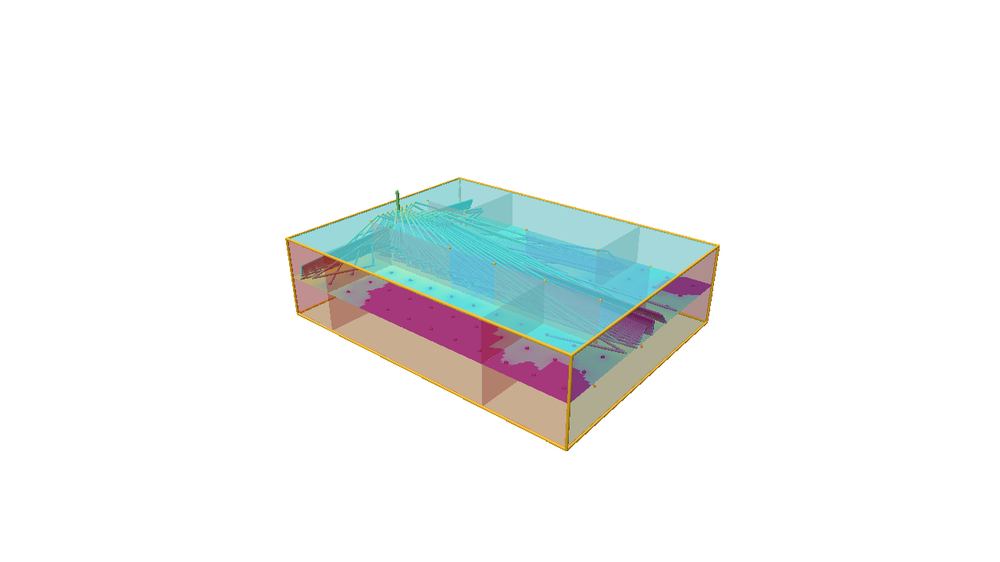

<a name="readme-top"></a>

# SBRSolver

<!-- ABOUT THE PROJECT -->
## About The Project

Implementation of the Shoot Bounce Relfect (SBR) method for electromagnetics simulation.

Features
* Transmitter Modelling
  - Ray generation via icosahedron sphere tessellation
  - Choose and apply theoretical antenna patterns (Hertzian Dipole, half-wave dipole, isotropic)
* Receiver Modelling
  - Reception sphere algorithm
  - Received field computation
* Scene Modelling
  - STL to triangle primitives
  - Bounding Volume Hierachy (BVH) implementation
  - Coplanar surface identification
* Ray Path Tracing
  - Ray math library
  - Ray launching algorithm
  - Ray intersection tests
  - Duplicate path removal
  - Image method path correction
* Field Calculation
  - TE/TM field decomposition
  - TE/TM field reflection
  - TE/TM field transmission

<p align="right">(<a href="#readme-top">back to top</a>)</p>

<!-- GETTING STARTED -->
## Getting Started

SBRSolver is a plain C++17 program built with [CMake](https://cmake.org). It compiles and runs
on Windows, Linux and macOS with any recent compiler (MSVC 2019+, GCC 8+, Clang 9+, Xcode 11+ on macOS 10.15 or newer).
Its dependencies are bundled as git submodules: [Eigen](https://eigen.tuxfamily.org), and
[Polyscope](https://polyscope.run) and [Tracy](https://github.com/wolfpld/tracy) for the built-in
viewer and the optional profiling.

### Prerequisites

* Git
* CMake 3.16 or newer
* A C++17 compiler
  - Windows: Visual Studio 2019/2022 with the *Desktop development with C++* workload
    (the command-line *Build Tools* are enough), or MinGW-w64 with the posix or mcf thread model
    (the MSYS2 UCRT64/MINGW64 packages; the older win32 thread model lacks `std::thread` before GCC 13)
  - Linux: `sudo apt install build-essential cmake git` (Debian/Ubuntu) or the equivalent, plus
    `xorg-dev libglu1-mesa-dev` for the built-in viewer (`libegl1-mesa-dev` for headless rendering)
  - macOS 10.15 (Catalina) or newer: `xcode-select --install` and `brew install cmake`
* Optional: Python 3 to run the regression test
* Optional: the [Tracy profiler](https://github.com/wolfpld/tracy/releases) GUI (version 0.14.1, the
  version of the bundled client) to watch the solver's performance live

### Build

```sh
git clone --recurse-submodules https://github.com/joshwang1995/SBRSolver.git
cd SBRSolver
cmake -S . -B build -DCMAKE_BUILD_TYPE=Release
cmake --build build --config Release --parallel
```

If you cloned without `--recurse-submodules`, fetch the submodules first with
`git submodule update --init --recursive`: Eigen, Polyscope (the viewer's rendering library, with its
own bundled GLFW, Dear ImGui and glm) and Tracy (the profiler client) are all git submodules, so
nothing has to be installed system-wide on any platform (on Linux the OpenGL/X11 development packages
listed above are needed to build the viewer). Eigen alone can also come from a system-wide install
(`apt install libeigen3-dev`, `brew install eigen`, `vcpkg install eigen3`).

Two CMake options control the extras: `-DSBR_BUILD_VIEWER=OFF` builds the solver without the viewer
(no OpenGL needed at all), `-DSBR_ENABLE_TRACY=ON` adds the profiler instrumentation (off by default,
see *Profiling with Tracy*).

The executable is written to `build/sbrsolver` on Linux/macOS. On Windows the Visual Studio generator
(CMake's default when Visual Studio is installed) puts it in `build\Release\sbrsolver.exe`; single-config
generators such as Ninja or MinGW Makefiles put it in `build\sbrsolver.exe`.
On Windows you can also open the folder in Visual Studio (*File | Open | Folder*) or generate a solution
with `cmake -S . -B build -G "Visual Studio 17 2022"`; both use the same `CMakeLists.txt`.

### Run

```sh
./build/sbrsolver                                                # runs SBRSolver_rev2/data/ground.ini
./build/sbrsolver SBRSolver_rev2/data/office.ini results/office  # another scene, into its own output directory
./build/sbrsolver my_case.ini                                    # custom config, results in output/ next to it
./build/sbrsolver SBRSolver_rev2/data/office.ini results/office --view   # ... and open the built-in 3D viewer afterwards
./build/sbrsolver --help
```

The first argument is a configuration file (see below), the second the output directory for the
VTK/CSV results. The configuration defaults to `ground.ini` in the data folder of the source tree
(the path is baked in at build time, so the program can be started from any working directory);
the output directory defaults to `output/` next to the configuration file and is created if missing.
`SBRSolver_rev2/data/output` holds the committed reference results that `ctest` compares against, so run
scenes other than `ground.ini` with an explicit output directory.

### Dense receiver layouts

The four scenes in `SBRSolver_rev2/data` carry the receiver layouts of the reference comparison (a
single receiver in the corner, a 1 m grid in the office, an 11 × 11 patch in Bahen, a 3 km line on
the ground plane). `SBRSolver_rev2/data/fine/` holds the same scenes with dense layouts for field
maps, each generated by `tools/generate_receivers.py` from the scene geometry so that every receiver
makes sense: inside the scene, at least a safety margin away from every wall, pillar and partition,
never on a surface, and away from the transmitter.

| Configuration | Receivers | Layout |
|---|---|---|
| `fine/ground.ini` | 9,981 | one every 0.1 m along the strip's centre line, y = 1 … 999 m, 3 m high (the whole line lies above the plane; the fringes of the two-ray interference are sub-metre near the transmitter) |
| `fine/corner.ini` | 6,320 | 0.25 m grid at 1.5 m over the whole 20 m × 20 m floor, 0.25 m clear of the wall |
| `fine/office.ini` | 1,728 | 0.25 m grid at 1.5 m over every room, offset so no receiver lies on a partition; 658 receivers (the room closed by the glass panel and the rooms without a line of sight) get no field with `max_reflections = 1` and `max_transmissions = 0`; tessellation 4, because 642 rays miss a grazing reflection at a few receivers next to a partition |
| `fine/bahen.ini` | 6,858 | 0.5 m grid at 1.5 m over the floor area the transmitter can reach without passing through a wall (the hall around the transmitter; the parts of the floor that walls seal off are left out), 0.3 m clear of every wall and pillar; 7 receivers in door recesses get no field with one reflection, and at tessellation 4 the launch misses 78 of the grid's 32,803 paths (grazing wall reflections, one each at 78 receivers, up to 10 dB there; tessellation 6 finds them all at 16 times the memory) |

Run them like any other scene, with an explicit output directory:

```sh
./build/sbrsolver SBRSolver_rev2/data/fine/office.ini results/office_fine --view
```

The generator reads the STL files, rasterises the walls at the receiver height and flood-fills
either the area reachable from the transmitter (`--region reachable`), everything inside the outer
walls (`--region enclosure`) or a plain box (`--region bbox`), then drops candidates closer than
`--margin` to a wall or `--tx-clearance` to the transmitter. `--spacing`, `--height`, `--bbox` and
`--line` shape the grid; `--plot` writes a top-down PNG of walls, transmitter and receivers (needs
Pillow). The first line of each `RX_*_fine.dat` records the command line it was made with. A denser
layout costs memory: the solver keeps a path list per launched ray and receiver (24 bytes each), so
the Bahen grid is 2562 × 6858 × 24 bytes, about 0.4 GB, and a 0.25 m grid would need four times
that.

### Results

`ElectricField.csv` lists the complex field `Ex, Ey, Ez` (V/m) at every receiver, written with
12 significant digits. The conventions are those of the RayTubeTracing reference solver (see
[Test](#test)): the source radiates `sqrt(P η₀ / 4π) · sqrt(gain(θ)) · θ̂` at unit distance, so
`|E|² / η₀` is the power density; every path contributes `exp(-j k L) / L` over its unfolded length
`L`; reflections and transmissions act on the TE and TM components of the field in the plane of
incidence with the Fresnel coefficients of the surface material. `RayPath.vtk` holds every path that
was found (exact image-method paths, one per receiver and interaction sequence) and `RxLocations.vtk`
the receivers with `|E|` and the field in dB(µV/m).

### Viewer



`--view` (or `viewer = true` in `[outputs]`) opens the built-in 3D viewer on the results once the run
has finished; the VTK/CSV files are still written, so ParaView and scripts keep working. The viewer
is built on [Polyscope](https://polyscope.run) and runs on Windows, Linux and macOS. Every item is an
overlay that can be switched on and off, in the *SBRSolver* panel or in Polyscope's structure list:

* the scene, coloured by **Face ID**, **Material ID** (with a legend of the material names) or
  **Surface ID** (the coplanar surface ids used by `[surface_materials]`);
* the mesh **edges**, with the **wedge edges** (two faces at an angle, the candidates for diffraction)
  highlighted; **diffracting edges** appear once the diffraction model exists;
* the **transmitter** with its antenna axes and the **receivers**, coloured by any field quantity:
  `|E|`, `|E|` in dBµV/m, received power in dBm (polarisation-matched isotropic antenna,
  `|E|² λ² / 4π η₀`), the phase or the magnitude of `Ex`, `Ey`, `Ez`;
* **all ray paths**, with a filter to show the paths of one receiver, coloured by receiver or by the
  number of interactions;
* a **2D interpolated view**: the field interpolated onto a regular grid in the receivers' plane
  (inverse-distance or nearest-neighbour interpolation of the complex components, then the chosen
  quantity);
* a **3D slice view**: the field interpolated onto a grid over the receivers' bounding box and drawn on
  a movable slice plane (buttons set the plane along x, y or z; the plane's own widget moves it freely).
  A flat receiver layout has no volume, so the 2D view covers it.

The scene is drawn half transparent by default so that the inside of a closed room is visible from
outside; the *Scene* section of the panel sets the transparency and can hide the faces that face the
camera (or those facing away) instead, which removes the near walls of a room whose normals point
outward (inward). Mouse: left-drag rotates, right-drag pans, wheel zooms; clicking a receiver, face
or path shows its values in the selection panel. Options for scripts and tests: `--screenshot FILE`
renders the view into a PNG (or JPEG) file and exits, `--viewer-frames N` closes the viewer after N
frames (N ≥ 1), and `--viewer-backend NAME` selects `openGL3_glfw` (a window), `openGL3_egl`
(headless rendering on Linux) or `openGL_mock` (no rendering, used by the tests). Without a display,
run with `xvfb-run`, or use the EGL backend together with `--screenshot` or `--viewer-frames`; an
interactive `--view` needs a window and fails without one.

### Profiling with Tracy

The solver is instrumented for the [Tracy](https://github.com/wolfpld/tracy) profiler. Configure
with `-DSBR_ENABLE_TRACY=ON` to build the instrumented solver: the preprocessing, every ray launch,
each receiver's image-path correction and field computation and the outputs are zones, the worker
threads are named, and each rendered viewer frame is a frame mark. Recording is *on demand* by
default: the zones cost nothing measurable until the Tracy GUI connects, and only what runs after
the connection is recorded, but the client itself adds about 0.2 s of start-up (timer calibration),
a few threads and a listening socket (TCP 8086) to every run, which is why the option is off by
default. To watch a long run, start the Tracy profiler (release 0.14.1 to match the bundled client),
press *Connect* (the solver appears in the list of clients on the local network, or enter its
address) and then start `sbrsolver`. For a short run, build with `-DSBR_TRACY_ON_DEMAND=OFF` and
run with the environment variable `TRACY_NO_EXIT=1`: the solver then records from start-up and waits
at exit until the GUI has connected and fetched the data. `TRACY_NO_BROADCAST` and
`TRACY_ONLY_LOCALHOST` (Tracy's own CMake options)
restrict the client to local connections.

### Configuration file

All simulation settings live in an INI-style text file. `SBRSolver_rev2/data/ground.ini` is the
documented reference; `corner.ini`, `office.ini` and `bahen.ini` are further examples. File names
inside the configuration are relative to the configuration file. Lines starting with `#` or `;` are
comments, and `#` preceded by a space starts an inline comment. Numbers in a value are separated by
spaces (matrix rows by `;`) and always use `.` as the decimal mark. Unknown sections or keys, missing
required keys, values of the wrong type or range and missing files are reported with their line number.

| Section | Key | Meaning |
|---|---|---|
| `[scene]` | `stl_file` | scene geometry (STL, ASCII or binary) |
| | `material` | material of `stl_file` (default: the first `[material]`) |
| | `save_edges`, `save_faces` | write `Edges.vtk` / `Faces.vtk` (default `true`); edge connectivity is computed per STL file, so an edge shared by two files appears once per file |
| `[geometry]` (repeatable) | `file`, `material` | a further STL file whose triangles all get `material` |
| `[transmitter]` | `position` | ray origin, `x y z` in metres |
| | `coordinate_system` | three rows of the TX frame (its x, y and z axes in global coordinates), e.g. `0 1 0; 0 0 1; 1 0 0` (default identity); the rows must be unit length, perpendicular and right-handed |
| | `power_watts`, `frequency_hz` | transmit power (default `1`) and frequency |
| | `tessellation` | icosahedron subdivision level 0 to 8; launches 10·4ⁿ+2 rays (default `2`, 162 rays). A path is only found when a launched ray bounces close enough to it, so use the smallest level at which the number of paths stops changing: `ground.ini` and `office.ini` need `3`, `bahen.ini` `4` |
| | `antenna_type` | `isotropic`, `hertzian_dipole` (default) or `half_wave_dipole` |
| | `pattern_file` | optional measured pattern; read and validated, not applied yet |
| `[receivers]` | `layout = line` | `line_start`, `line_end`, `resolution` (generated layouts are limited to 100 million receiver × ray combinations, about 3 GB) |
| | `layout = plane` | `x_min`, `y_min`, `x_max`, `y_max`, `height`, `resolution` |
| | `layout = file` | `file`, an `RX_*.dat` location file |
| `[ray_tracing]` | `max_reflections`, `max_transmissions` | bounce limits (default `1` and `0`) |
| | `use_fresnel_coefficients` | `true` (default): Fresnel reflection and transmission coefficients of a half space with the material's permittivity and conductivity; `false`: every surface is a perfect electric conductor (total reflection, no transmission) |
| | `threads` | worker threads for ray launching and field computation; `0` (default) uses every hardware thread |
| `[material]` (repeatable) | `name`, `reflection_loss`, `transmission_loss`, `rel_conductivity`, `rel_permittivity_re`, `rel_permittivity_im`, `frequency_hz` | one section per material with a unique name; the first is the default for `stl_file`. The field computation uses the complex permittivity `rel_permittivity_re - j rel_conductivity / (2π f ε₀)` at the transmitter frequency; the other values are read but not applied. `frequency_hz` defaults to the transmitter frequency |
| `[surface_materials]` | `<surface id> = <material name>` | override whole coplanar surfaces; ids are the `CoplanarID` field of `Faces.vtk`, written as plain decimal numbers, each at most once |
| `[outputs]` | `ray_paths`, `receivers`, `field_csv`, `icosahedron` | which result files to write (defaults `true`, `true`, `true`, `false`) |
| | `viewer` | open the built-in viewer after the run (default `false`; `--view` does the same) |

The scene, receiver layout and material parameters are no longer set in the source code.

**Assigning materials to surfaces.** STL files carry no material information, so there are two ways
to say which surface is made of what. The usual way is one STL file per material: export the walls,
windows, floor and so on as separate files from Blender or your CAD tool, name the first in `stl_file`
with its `material`, and list the others in `[geometry]` sections. For finer control, or for a single
file, `[surface_materials]` overrides whole coplanar surfaces by id. To find an id, run the scene once,
open `output/Faces.vtk` in ParaView and colour by `CoplanarID` (or `MaterialID` to check the result).
Ids are assigned in file order and change if the geometry changes; a run that names an unknown id
still writes `Faces.vtk` so the valid ids can be looked up. The program prints how many triangles each
material received. `SBRSolver_rev2/data/office.ini` shows both mechanisms.

### Test

```sh
cd build && ctest -C Release --output-on-failure
```

This runs the four scenes in `SBRSolver_rev2/data` (`ground`, `corner`, `office`, `bahen`), their dense
receiver layouts in `data/fine` (`sbrsolver_run_<scene>_fine`; with a Python interpreter,
`sbrsolver_fields_<scene>_fine` then checks with `tools/check_fields.py` that every receiver got one
finite field at its own position, non-zero everywhere on the ground line and the corner floor), and
checks `ground` and `office` twice and `corner` and `bahen` once:

* `sbrsolver_reference_*`: the `ground` and `office` fields against the results committed in
  `SBRSolver_rev2/data/output/ElectricField.csv` and `SBRSolver_rev2/data/reference/office_ElectricField.csv`
  (the same build on another platform or compiler must reproduce them);
* `raytube_*`: every scene against the RayTubeTracing reference solver (Takahiro Hashimoto's ray-tube
  tracer, `tools/raytube/RayTubeTracing.exe`). The field at every compared receiver must agree with
  the reference to every digit it prints, and the number of paths per receiver must be the same. All
  receivers are compared, except for `ground`, where only the first kilometre (receivers 0 to 1000 of
  3000) is compared because the reference loses the ground reflection farther out on the 10 m wide
  strip. On Windows `ctest` runs the executable itself; elsewhere it compares with the reference
  output committed in `SBRSolver_rev2/data/reference/raytube/`, unless configured with
  `-DSBR_RAYTUBE_EXE=tools/raytube/RayTubeTracing.exe -DSBR_RAYTUBE_LAUNCHER=wine64`.
  `tools/raytube/README.md` describes the conversion of the configuration files, the tolerances and
  the limits of the reference.

The viewer has tests of its own: `viewer_unit_tests` (the scene data model and the field
interpolation, no display needed), `viewer_smoke_mock` and `viewer_smoke_mock_volume` (a synthetic
run through every overlay, with flat and with layered receivers, using the rendering-free mock
backend), `viewer_mock_office` (the whole viewer on the office scene with the mock backend, every
platform), `viewer_cli_rejects_frames`, `viewer_cli_rejects_screenshot_type` and
`viewer_cli_rejects_backend` (malformed viewer options are refused before the run) and, where
`xvfb-run` exists, `viewer_screenshot_office` (a real
rendering into a PNG, which fails when no file is written).

The same build and test matrix runs in GitHub Actions on Ubuntu (GCC and Clang), macOS and Windows
(where the reference solver is run) for every pull request and every pushed commit; CI configures
with `-DSBR_REQUIRE_REFERENCE_TESTS=ON` so a runner without Python fails instead of skipping the
comparisons, and with `-DSBR_ENABLE_TRACY=ON` so the instrumented solver is built and tested on
every platform.

<p align="right">(<a href="#readme-top">back to top</a>)</p>

<!-- USAGE EXAMPLES -->
## Contributing

**_Git is used for version control in this entire project. Any use of Git without fully understanding the consequence of each action can be detrimental. Read the following resource to get started with using Git: https://git-scm.com/book/en/v2_**

1. Do not commit directly to the `master` branch. It should only contain verified working code.
2. Create your own branch from `master`: `git switch -c my-feature master`
3. Commit frequently so you can go back if something goes wrong. Think of it as quick save in video games:
   `git add -A && git commit -m "Short, descriptive message"`
4. Push your branch to GitHub: `git push -u origin my-feature`
5. Once your fix/implementation is finished, open a pull request to merge it into `master`.
   **Make sure the build and `ctest` pass on your machine, and get someone else to review it for you.**

Any Git client (command line, Visual Studio, VS Code, GitKraken, ...) works for the steps above.

<p align="right">(<a href="#readme-top">back to top</a>)</p>

<!-- TROUBLESHOOTING -->
## Troubleshooting

* **CMake reports that Eigen was not found.** The submodule folder `eigen/` is empty. Run
  ```sh
  git submodule update --init --recursive
  ```
  in the repository root and configure again.
* **`Error: invalid configuration`** at start-up. The message lists each offending line of the
  configuration file (unknown key, bad value, missing file). File names inside the configuration are
  relative to the configuration file, not to the current directory.
* **A path is missing, or the field changes with `tessellation`.** A launched ray has to bounce
  close enough to the exact path for the reception sphere to capture it; raise `tessellation` until
  the number of paths in `RayPath.vtk` stops changing. The `raytube_*` tests show which receivers lost
  a path.
* **`--view` ends with "no display is available" or "no Polyscope backends could be initialized".**
  There is no display (a remote shell, a container, CI), so the interactive viewer refuses to start
  rather than run without a window. Use `xvfb-run -a ./build/sbrsolver ... --screenshot view.png`,
  or `--screenshot` / `--viewer-frames N` with `--viewer-backend openGL3_egl` on Linux, to render
  without a display, or `--viewer-backend openGL_mock --viewer-frames N` to run the viewer code
  without rendering. On a desktop, the graphics driver must provide OpenGL 3.3.
* **The Tracy GUI shows no client.** The solver must be built with `-DSBR_ENABLE_TRACY=ON`; the
  GUI and the bundled client must be the same version (0.14.1);
  a firewall may block the discovery broadcast (UDP 8086) or the connection (TCP 8086), in which case
  enter the machine's address in the GUI; and the solver must be running while you connect: start a
  long run, or for a short one build with `-DSBR_TRACY_ON_DEMAND=OFF` and run with `TRACY_NO_EXIT=1`
  (see *Profiling with Tracy*); `--view` keeps the process alive, but in the on-demand build only the
  viewer's frames are then recorded.
* **Parallelism.** The solver runs the ray launches and the per-receiver field computation on all
  hardware threads by default, with results identical to a single-threaded run. Set `threads = 1` in
  `[ray_tracing]` to run serially (for example when timing or debugging), or a specific count to leave
  cores free. No build option is involved; the standard library's threads are used on every platform.

<p align="right">(<a href="#readme-top">back to top</a>)</p>
